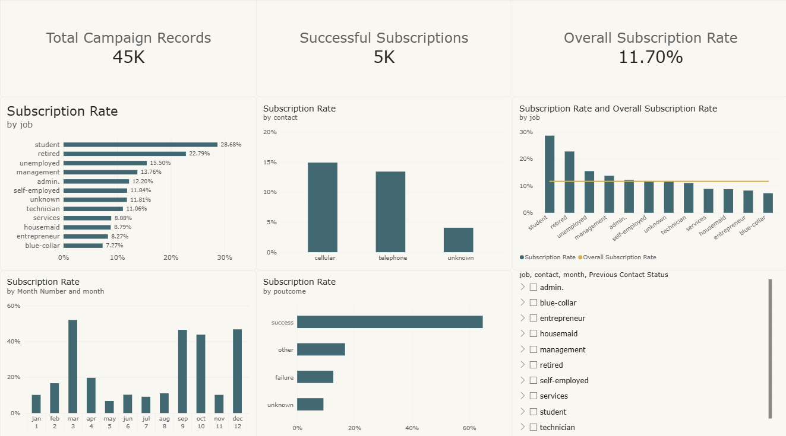

# bank-marketing-campaign-performance-analysis
Repository about analysis of bank marketing term-deposit campaign performance using the UCI Bank Marketing dataset. Moro, S., Rita, P., & Cortez, P. (2014). Bank Marketing [Dataset]. UCI Machine Learning Repository. https://doi.org/10.24432/C5K306. Licensed under CC BY 4.0.

# Bank Marketing Campaign Performance Dashboard

## Dashboard Preview

## Business Objective

Analyze bank marketing campaign records and term-deposit subscription rates across customer segments, communication channels, campaign months, and prior campaign outcomes

## Tools Used

- Microsoft Power BI
- Power Query
- DAX

## Key Findings

- Across 45K total campaign records and 5K successful subscriptions (11.70% Overall Subscription Rate), `student` (28.68%), `retired` (22.79%), `unemployed` (15.50%), and `management` (13.76%) achieve the highest subscription rates, whereas `blue-collar` (7.27%), `entrepreneur` (8.27%), `housemaid` (8.79%), and `services` (8.88%) convert lowest
- Communication channel and prior outcome show clear differences: `cellular` (~15%) outperforms `telephone` (~13%) and `unknown` (~4%), while prior `success` (~65%) converts far higher than `other` (~16%), `failure` (~12%), and `unknown` (~9%), with monthly peaks in `mar` (~52%), `dec` (~47%), `sep` (~46%), and `oct` (~44%)
- The current dashboard view does not yet display the number of contact attempts (`campaign`) against campaign outcomes, and data interpretation requires strict guardrails (Portugal bank data from May 2008–November 2010, no unique customer ID, `campaign` reflecting contacts per record rather than unique campaigns, correlation rather than causation, and no campaign cost data for ROI)

## Recommendations

- Focus targeted outreach on high-converting segments (`student`, `retired`, `unemployed`, `management`), `cellular` outreach, prior `success` leads, and peak-converting months (`mar`, `sep`, `oct`, `dec`), while testing tailored messaging or lower-cost touchpoints for lower-converting segments such as `blue-collar` and `entrepreneur`
- Use the interactive slicer (`job`, `contact`, `month`, `Previous Contact Status`) to cross-filter segments and isolate specific campaign slices before making targeting adjustments
- Add a dedicated visual evaluating contact attempt counts (`campaign`) vs. subscription rate, pair campaign logs with cost data if ROI tracking is desired, and apply all dataset guardrails rather than assuming Indonesia relevance, current behavior, unique customer counts, or causal impact

## Files

- Power BI Dashboard (bank-marketing-campaign-performance-dashboard.pbix)
- Analytical Report (report.txt)
- DAX Measures (Total Campaign Records, Successful Subscriptions, Overall Subscription Rate, Subscription Rate)
- Data Dictionary (BankMarketing table, including job, contact, Month Number, month, poutcome, and Previous Contact Status)

## License

Moro, S., Rita, P., & Cortez, P. (2014). Bank Marketing [Dataset]. UCI Machine Learning Repository. https://doi.org/10.24432/C5K306. Licensed under CC BY 4.0.